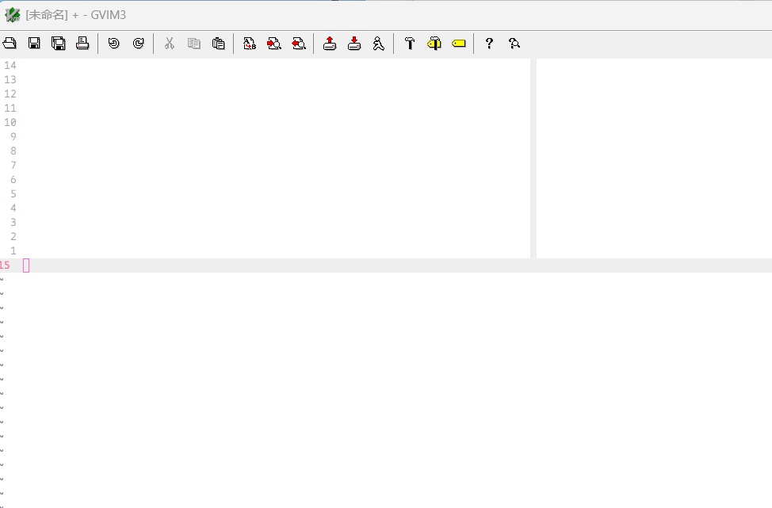
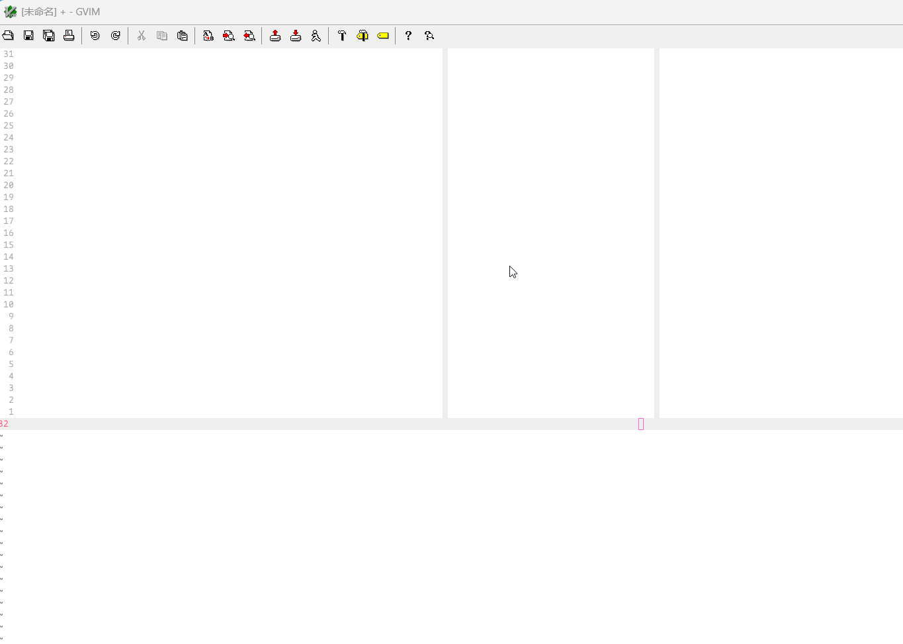

[English](README.md) | [简体中文](README_CN.md)

# Vimio

Vimio 是一个轻量级的 Vim 插件，用于直接在编辑器中仅使用 ASCII 和 Unicode 字符绘制基于文本的图表（例如流程图、架构草图和布局模型）。

```
                __     __  _               _
                \ \   / / (_)  _ __ ___   (_)   ___
                 \ \ / /  | | | '_ ` _ \  | |  / _ \
                  \ V /   | | | | | | | | | | | (_) |
                   \_/    |_| |_| |_| |_| |_|  \___/
```

灵感来自 Nadim Khemir 的 [Asciio](https://github.com/nkh/P5-App-Asciio)。

使用此插件，您可以绘制：


```txt
╔════════════════════════════════════════════════════════╗  SGMI(GE) ┌───────┐
║   MAIN BOARD                       ┌────────┐RGMII     ║  ┌───────>│sw6    │
║              SGMII┌──────┐  MDI    │(0)     │    ┌───┐ ║  │   ┌───>│0x01   │
║   ┌────────┐  ┌──>│sw1   │<───────>│P0   RG2│<──>│sw4│<╫──┘   │    └───────┘
║   │GE0/ETH2│<─┘   └──────┘         │     (5)│    │   │ ║      │
║   │  BMC   │      ┌──────┐  MDI    │(1).---.│    └───┘ ║      │    ┌───────┐
║   │GE1/ETH3│<────>│sw2   │<───────>│P1 |sw3|│          ║      ├───>│sw7    │
║   └────────┘      └──────┘         │   '---'│RGMII     ║      │    │0x02   │
║                   ┌──────┐  MDI    │(2)     │    ┌───┐ ║      │    └───────┘
║   ┌──────────┐    │    P0│<───────>│P2   RG1│<──>│sw5│ ║      │
║   │CPU0      │<──>│NIC   │  MDI    │(3)  (4)│    │   │ ║      │    ┌───────┐
║   └──────────┘    │    P1│<───────>│P3      │    └───┘ ║      ├───>│sw8    │
║             PCIEX2└──────┘         └────────┘      ^   ║      │    │0x03   │
╚════════════════════════════════════════════════════╪═══╝      │    └───────┘
                                             SGMI(GE)│          │
                                                     v          │    ┌───────┐
                 ┌─────────────────────────────┐  .-----.       ├───>│sw9    │
                 │                             │  |     |       │    │0x01   │
                 │                             │  |other|       │    └───────┘
                 │                             │  |     |       │    ┌───────┐
                 │     .---------.             │  '-----'    ┌──┼───>│sw10   │
                 │     |   BMC   |             │<────────SGM─┼──┼────│0x02   │
                 │     '---------'             │             │  │    └───────┘
                 │                             │             │  │  ┌─────────┐
                 │                             │             │  └─>│Analog   │
                 │    OTHER MAIN BOARD         │             └────>│Switch   │
                 └─────────────────────────────┘                   └─────────┘
```

**这是两个演示:**





---

## 功能列表

- 虚拟文本模式：在任何地方绘制，甚至超出行尾
- 线条工具：水平、垂直、对角线，具有智能连接和自动交叉点字符
- 方框图：即时矩形、自适应角、自动箭头
- 橡皮擦：干净地删除字符，包括宽字形
- 剪贴板：精确复制/剪切/粘贴形状或字符
- 形状模板：ASCII 艺术、横幅、LED 和用户定义的集
- 实时预览：浮动叠加层跟随您的光标
- 高亮标记：选择不规则形状进行细粒度编辑
- CJK 支持：使用中文、日文和韩文字符进行绘制
- 支持自定义的字体 [vimiomono](https://github.com/qindapao/custom_font) 中的特殊字符进行绘制更漂亮的图表

---

## 安装

### Requirements

- Vim 8.2+ 编译于：
  - `+popupwin` (用于弹出窗口支持)
  - `+mouse` (用于鼠标交互，可选)
  - `+clipboard` (用于系统剪贴板集成)

- 在 Linux 上的剪贴板支持：
  - 安装一个带有图形界面的 Vim 版本，例如 `vim-gtk3`：
    ```bash
    sudo apt install vim-gtk3
    ```

- 推荐使用 Vim 的图形界面版本（例如 gVim）
  ⚠️ **Neovim 不受支持**：因为 Vimio 依赖 Vim 8 的 `popup_*()` API，而 Neovim 没有实现该 API。未来可能会进行适配。
  ⚠️ **终端 Vim 部分受支持**：许多功能可以使用，包括弹出窗口（在某些终端中支持透明），但键映射可能与终端快捷键冲突，渲染效果可能因终端模拟器而异。完全支持和优化计划将在未来版本中实现。

### 使用 [vim-plug](https://github.com/junegunn/vim-plug) 安装

```vim
Plug 'qindapao/vimio'
```

### 手动 (packages) 安装

```sh
mkdir -p ~/.vim/pack/vimio/start
cp -r /path/to/vimio ~/.vim/pack/vimio/start
```

重新加载 Vim 或运行:

```vim
:packloadall
```

### 配置

要禁用默认映射：

```vim
let g:vimio_enable_default_mappings = 0
```

然后检查 `plugin/vimio.vim` 中的所有默认映射，并根据需要在 `.vimrc` 中重新定义它们。


要定义您自己的一组形状模板：

```vim
let g:vimio_custom_shapes_dir = expand('~/.vim/vimio_custom_shapes')
let g:vimio_user_shapes_define_graph_functions = [
      \ ['Vimio__DefineSmartDrawShapesanimal', [0], 0, 'my_animal1.vim'],
      \ ['Vimio__DefineSmartDrawShapesanimal', [0], 0, 'my_animal2.vim'],
      \ ]
```

然后将自定义模板文件放置在您指定的目录中 (`g:vimio_custom_shapes_dir)`。

⚠️ `重要提示`：请避免在自定义模板中使用以下文件名，因为它们是插件保留的，可能会导致冲突：

basic.vim
figlet.vim
led.vim
animal.vim

使用独特的名称，如 `my_animal.vim` `custom_led.vim` 等，以确保兼容性。

---

## 快速开始

进入虚拟文本模式：

```vim
<Leader>vea
```

画一个盒子：

```vim
M-l / M-j / M-h / M-k   " draw lines in four directions
```

切换线条样式：

```vim
sl   " cycle line types (ASCII, Unicode, bold, etc.)
```

粘贴形状：

```vim
C-M-Space   " paste shape from clipboard
```

粘贴前预览：

```vim
C-j/k/h/l   " move cursor and show floating preview
```

---

## 示例

在几秒钟内绘制一个矩形：

```
.--------.
|        |
|        |
'--------'
```

切换到 Unicode 方框图：

```
┌────────┐
│        │
│        │
└────────┘
```

从形状库中插入一只猫：

```
 /\_/\
( o.o )
 > ^ <
```

---

## 定义你自己的形状

创建一个类似 `draw_shaps/animal.vim` 的文件并定义你的 ASCII 艺术。
将其注册到 `autoload/vimio/shapes.vim` 中。有关详细信息，请参阅 `vimio.txt` 第 14 节。

---

## 项目历史

Vimio 的灵感来自于 [Asciio](https://github.com/nkh/P5-App-Asciio)，这是 Nadim Khemir 在 Perl 5 中开发的面向对象的 ASCII/Unicode 图表软件，该软件已经发展了二十多年。

虽然 Vimio 的目标不是复制 Asciio 的完整功能集，但它带来了一种直接在 Vim 中直接绘制图表的集中、简约的方法。我与 Nadim 合作开发了 Asciio 的后期版本，并在构建 Vimio 时大量借鉴了它的设计理念。

---

## 已知限制

- 目前主要在 GUI Vim（例如 gVim）中进行测试。
- 终端 Vim 支持是实验性的，可能存在渲染问题。
- 绘图模式不支持制表符。
- 不支持 Neovim，也许以后会适配。

---

## 许可证

MIT License © 2025 qindapao

---

## 鸣谢

灵感来自于 Nadim Khemir 的 [Asciio](https://github.com/nkh/P5-App-Asciio)。

